### Hi, I'm Jan.

I work on websites, applications, digital products and automation, currently at [Webforte Technologies](https://webforte.cz).

**What I do** &nbsp;·&nbsp; Websites &nbsp;·&nbsp; Web applications &nbsp;·&nbsp; AI & automation &nbsp;·&nbsp; SEO &nbsp;·&nbsp; E-commerce

**Also** &nbsp;·&nbsp; LLM APIs &nbsp;·&nbsp; RAG &nbsp;·&nbsp; vector databases &nbsp;·&nbsp; Shoptet

Most of my work lives in private repositories, so the repo list below is short on purpose.
